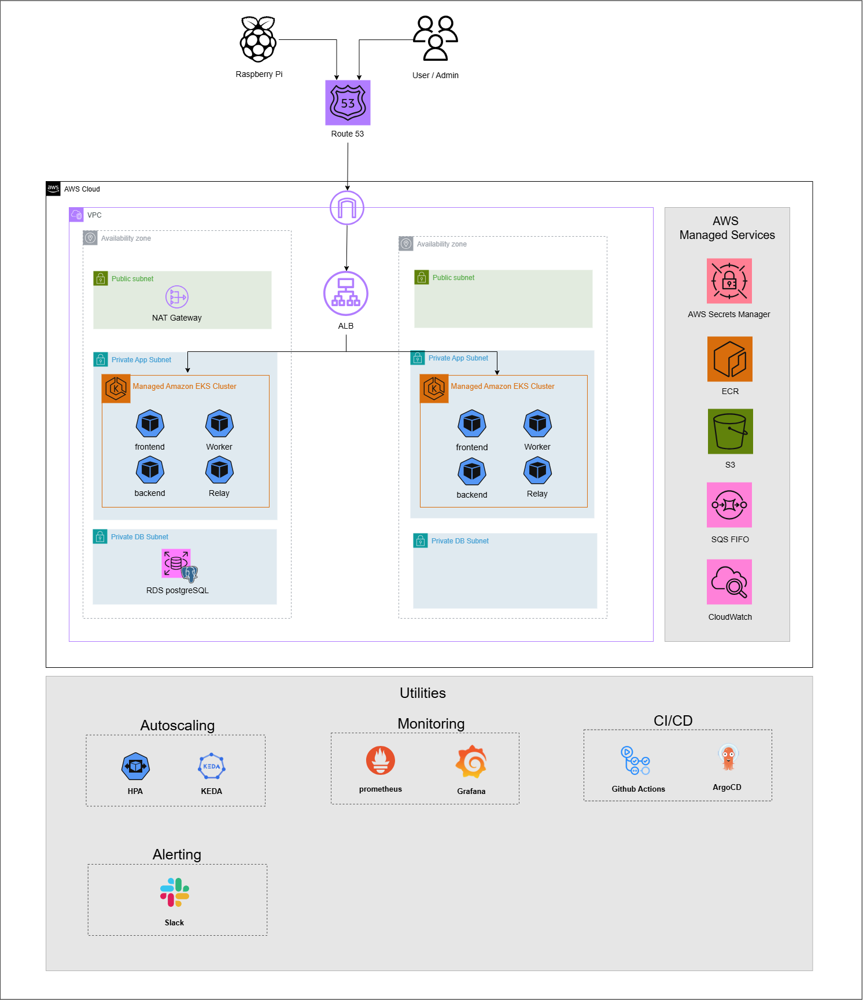

# parking-guardian-infra

Parking Guardian 의 AWS 인프라를 Terraform 으로 구축하는 레포지토리입니다. 콘솔에서 수동으로 만든 리소스 없이, VPC 부터 EKS, RDS, S3, SQS, 도메인과 인증서까지 모두 코드로 관리합니다.

이 레포에는 **Terraform 코드만** 있습니다. 설계 문서(`docs/`), 변수 값(`*.tfvars`), backend 설정(`terraform/backend.hcl`), State, 실행 로그와 plan 파일은 Git 에 올리지 않습니다.

## 목차

- [프로젝트에서의 역할](#프로젝트에서의-역할)
- [인프라 아키텍처](#인프라-아키텍처)
- [스택 구성](#스택-구성)
- [주요 설계 결정](#주요-설계-결정)
- [비용 구조](#비용-구조)
- [사전 조건과 인증](#사전-조건과-인증)
- [구축 순서](#구축-순서)
- [삭제 순서](#삭제-순서)
- [운영 시 주의 사항](#운영-시-주의-사항)
- [관련 레포지토리](#관련-레포지토리)

## 프로젝트에서의 역할

Parking Guardian 은 장애인 전용 주차구역의 불법주차를 AI 로 판정하는 Multi-Tenant 서비스입니다. 세 개의 레포지토리가 역할을 나눕니다.

| 레포지토리 | 담당 |
|---|---|
| App | 애플리케이션 코드, 컨테이너 이미지 빌드(CI) |
| **Infra (이 레포)** | AWS 리소스와 클러스터 기반 도구(Terraform) |
| Config | Kubernetes 매니페스트, Argo CD 배포 설정 |

이 레포는 클러스터 **안에 올라가는 애플리케이션**(Deployment, Service 등)은 다루지 않습니다. 그것은 Config 레포의 몫입니다. 이 레포가 클러스터 안에 직접 설치하는 것은 ALB Controller, External Secrets Operator, Argo CD 세 가지뿐입니다. KEDA, Prometheus 등 나머지는 Argo CD 가 Config 레포에서 설치합니다.

## 인프라 아키텍처



- 노드와 DB 는 Private Subnet 에만 있고, 외부에서 들어오는 길은 ALB 하나입니다.
- Pod 가 AWS 를 부를 때는 장기 Access Key 대신 **EKS Pod Identity** 로 서비스별 최소 권한 IAM 역할을 받습니다.
- GitHub Actions 가 ECR 에 이미지를 올릴 때도 **GitHub OIDC** 임시 자격 증명을 씁니다(앱 레포의 `develop`, `main` 브랜치만 허용).

## 스택 구성

State 는 스택마다 따로입니다(같은 S3 버킷, 다른 key). 스택 사이의 값 전달은 `terraform output` 의 값을 다음 스택의 `terraform.tfvars` 에 넣는 방식입니다.

| 순서 | 스택 | 수명 | 만드는 것 |
|---|---|---|---|
| 1 | `bootstrap` | 영구 | State 저장 S3 버킷(버전 관리, 암호화, 퍼블릭 차단, S3 네이티브 잠금). 이 스택만 로컬 State |
| 2 | `network` | 영구 | VPC, Subnet 6개(Public / Private App / Private DB 각 2), 라우트, S3 Gateway Endpoint, 보안 그룹(ALB, 노드, RDS) |
| 3 | `data` | 영구 | Budgets, Route 53 영역, ACM 인증서, S3(사진, 모델, ALB 로그), ECR 4개, SQS FIFO 판정 큐와 DLQ, Secrets Manager(빈 컨테이너), RDS, GitHub OIDC 와 CI 용 IAM 역할 |
| 4 | `cluster` | 매번 생성·삭제 | NAT Gateway, EKS, 관리형 노드 그룹, 관리형 Add-on(VPC CNI, CoreDNS, kube-proxy, Pod Identity Agent, metrics-server, EBS CSI, CloudWatch Observability), 서비스별 Pod Identity 역할(backend, inference, worker, relay, KEDA) |
| 5 | `platform` | 매번 생성·삭제 | Helm 으로 AWS Load Balancer Controller, External Secrets Operator, Argo CD 설치와 각 IAM 역할 |
| 6 | `dns-record` | 가장 나중 | ALB 가 만들어진 뒤 Route 53 Alias 레코드(`parking.<도메인>`) |

의존 관계는 `bootstrap → network → data → cluster → platform → (Config 레포 적용으로 ALB 생성) → dns-record` 입니다.

### Phase 2(비동기 구조)를 위한 인프라

- SQS FIFO 판정 큐와 DLQ(재수신 3회 후 DLQ, 서버 측 암호화, HTTPS 전용)
- 사진 버킷의 `inbox/` 7일 수명 주기. 큐 보존 기간보다 길어야 한다는 조건을 Terraform 검증으로 강제
- ECR `worker` 리포지토리, Worker 와 Relay 의 Pod Identity 역할(큐 소비와 발행, 사진 읽기와 쓰기, 모델 읽기)
- KEDA operator 의 Pod Identity 역할(큐 길이 조회 권한 하나)

## 주요 설계 결정

| 결정 | 이유 |
|---|---|
| 스택 분리와 State 분리 | 수명이 다른 것을 나눕니다. 비용이 큰 `cluster`, `platform` 만 매번 지우고 만들고, `network`, `data` 는 유지합니다. |
| NAT 경로를 `cluster` 스택이 추가 | NAT 를 지워도 `network` 스택의 라우트 테이블이 영향받지 않도록, 경로는 별도 `aws_route` 리소스로 `cluster` 가 소유합니다. |
| Pod Identity 와 OIDC | Access Key 를 코드, 설정, GitHub Secrets 에 두지 않습니다. 서비스마다 필요한 권한만 가진 역할을 따로 둡니다. |
| 비밀 값은 Terraform 밖 | Secrets Manager 는 빈 컨테이너만 만들고 값은 CLI 로 직접 넣습니다. 비밀번호가 State 와 Git 에 남지 않습니다. RDS 마스터 비밀번호는 RDS 관리형입니다. |
| ALB 접속 IP 제한 | `alb_ingress_cidrs` 에 기본값이 없습니다. 값을 빠뜨린 채 apply 해서 ALB 가 전체 공개되는 사고를 막기 위해서입니다. |
| 단일 환경 | dev / prod 구분 없이 환경 하나만 둡니다. |
| 노드 수 고정 | 노드 그룹은 min 0 / max 3 이며 실제 desired 는 CLI 로 조정합니다(`desired_size` 는 `ignore_changes`). **Cluster Autoscaler 와 Karpenter 는 설치하지 않았습니다.** 앱 Pod 수는 KEDA 와 HPA 가 조절하지만 노드는 늘지 않습니다. |

### AWS Free 플랜 제약에 따른 설계와의 차이

| 항목 | 설계 | 실제 | 이유 |
|---|---|---|---|
| 노드 인스턴스 | `m7i.large` | `m7i-flex.large` | Free 플랜은 Free Tier 적격 인스턴스만 허용. 서울 리전 x86 중 8 GiB 는 이 타입뿐 |
| State 암호화 | KMS 고객 관리형 키 | SSE-S3 | SCP 가 KMS 생성을 거부 |
| RDS 자동 백업 | 7일 | 1일 | Free 플랜 상한 |
| 도메인 | Route 53 에서 등록 | 외부 등록기관에서 구매 후 NS 위임 | Free 플랜은 Route 53 도메인 등록 불가 |
| Cost Anomaly Detection | 사용 | 제외 | 범위에서 뺌(AWS 기본 모니터만) |

## 비용 구조

EKS 컨트롤 플레인, 노드, NAT Gateway 가 비용의 대부분이라 `cluster` 와 `platform` 은 쓸 때만 켭니다. 금액은 서울 리전 시간당 기준 대략값이며 정확한 단가는 AWS Pricing Calculator 로 확인하세요.

| 리소스 | 시간당 | 비고 |
|---|---|---|
| EKS 컨트롤 플레인 | $0.10 | |
| 노드 `m7i-flex.large` | 약 $0.12 / 대 | 현재 설정은 3대 |
| NAT Gateway | 약 $0.06 + 전송량 | |
| RDS `db.t4g.micro` | 소액 | `stop-db-instance` 로 정지 가능, 7일 뒤 자동 재시작 |

비용 끄는 방법:

| 방법 | 남는 비용 | 복구 |
|---|---|---|
| 노드만 0대로 | 컨트롤 플레인 + NAT | `desiredSize` 를 되돌림 |
| `platform`, `cluster` destroy | 거의 없음(`network`, `data` 만 남음) | `terraform apply` 와 Config 레포 재적용 |

Budgets 가 월 $100 기준으로 실제 누적 $50, $100 도달 시 이메일 경보를 보냅니다. 자동 조치는 없습니다.

## 사전 조건과 인증

- Terraform 1.10 이상(S3 backend 의 `use_lockfile` 사용. DynamoDB 잠금 테이블 없음)
- AWS CLI v2. Terraform 전용 IAM 사용자의 Access Key 를 **`parking-guardian` 프로필**에 등록(리전 `ap-northeast-2`)

```powershell
aws configure --profile parking-guardian    # Access Key, Secret Key, 리전 ap-northeast-2
$env:AWS_PROFILE = "parking-guardian"       # PowerShell. 터미널을 새로 열면 다시 설정
```

```bash
export AWS_PROFILE=parking-guardian         # Git Bash
```

Terraform 은 AWS CLI 와 같은 기본 자격 증명 체인을 씁니다. provider 블록에는 `access_key`, `secret_key`, `profile` 을 적지 않으며, 키를 코드, `tfvars`, Git 에 넣지 않습니다. 프로필은 `AWS_PROFILE` 환경변수로만 고릅니다.

**모든 `terraform` 명령 전에 신원을 확인합니다.** 다른 프로젝트의 프로필이 기본 프로필일 수 있어, `AWS_PROFILE` 을 빠뜨리면 다른 계정에 리소스가 만들어집니다.

```powershell
aws sts get-caller-identity     # Account 와 Arn 이 Parking Guardian 용 Terraform 사용자인지 확인
```

## 구축 순서

각 스택은 `plan` 으로 변경 내용을 확인한 뒤 `apply` 합니다. 완료 기준은 apply 직후 다시 `plan` 했을 때 `No changes.` 가 나오는 것입니다. `terraform.tfvars` 는 스택 폴더의 `terraform.tfvars.example` 을 복사해 값을 채웁니다(이 파일은 Git 에 올라가지 않습니다).

### 1. bootstrap

변수 파일이 필요 없습니다. 계정 ID 는 실행 신원에서 읽습니다.

```powershell
cd terraform\stacks\bootstrap
terraform init
terraform plan
terraform apply
terraform output -raw backend_hcl | Out-File -Encoding ascii ..\..\backend.hcl   # 이후 스택이 공유하는 backend 설정
```

Git Bash 에서는 `terraform output -raw backend_hcl > ../../backend.hcl` 을 씁니다. 형식은 `terraform/backend.hcl.example` 참고. 이후 스택은 모두 아래처럼 초기화합니다.

```powershell
terraform init -backend-config=..\..\backend.hcl
```

계정이 AWS Organizations 의 멤버이면 SCP 가 S3 생성을 막을 수 있습니다. `aws s3api list-buckets` 가 "explicit deny in a service control policy" 로 실패하면 관리 계정에서 SCP 를 고쳐야 합니다.

### 2. network

NAT 를 제외한 비용 0 인 네트워크 골격입니다. **`alb_ingress_cidrs` 는 기본값이 없어 반드시 지정해야 합니다.**

```powershell
cd terraform\stacks\network
Copy-Item terraform.tfvars.example terraform.tfvars    # alb_ingress_cidrs 를 ["<내 공인 IP>/32"] 로 수정
terraform init -backend-config=..\..\backend.hcl
terraform plan                                         # ALB 규칙이 의도한 CIDR 인지 확인한 뒤에 apply
terraform apply
```

- 내 공인 IP 확인: `curl https://checkip.amazonaws.com`
- 공인 IP 가 바뀌면 값을 고쳐 apply 합니다. 새 규칙을 먼저 만들고 옛 규칙을 지워 끊김이 없습니다.
- 전체 공개가 필요하면 `["0.0.0.0/0"]` 을 **명시**합니다. 현장 장비의 공인 IP 가 고정이 아니면 공개 전에 장비 접속 방식을 먼저 정해야 합니다.
- 빈 목록, IPv6, 접두어 없는 주소, 호스트 비트가 있는 값은 plan 단계에서 거부됩니다.

### 3. data

`terraform.tfvars` 에 network 출력값(`private_db_subnet_ids`, `rds_security_group_id`), 경보 받을 이메일, 도메인(`domain_name`)을 넣습니다. 도메인은 코드와 README 에 적지 않습니다.

```powershell
cd terraform\stacks\data
Copy-Item terraform.tfvars.example terraform.tfvars
terraform init -backend-config=..\..\backend.hcl
```

**DNS 는 두 번에 나눠 apply 합니다.** ACM 인증서의 DNS 검증은 등록기관이 이 영역으로 NS 를 위임한 뒤에만 통과하므로, 한 번에 apply 하면 검증 대기가 타임아웃(75분)으로 실패합니다. PowerShell 에서는 `-target` 값을 따옴표로 감쌉니다.

```powershell
terraform apply -target="aws_route53_zone.this"     # 1차: 영역만
terraform output route53_name_servers               # 이름 서버 4개를 등록기관의 네임서버 설정에 입력(끝의 점 제외)
nslookup -type=NS <도메인> 1.1.1.1                    # 위임이 전파됐는지 확인
terraform apply                                     # 2차: 나머지 전부(인증서 발급까지 수 분)
```

apply 뒤 **Terraform 밖에서 하는 작업**(1회):

```powershell
# 모델 업로드: 모델 파일은 Git 에 없다
$models = terraform output -raw models_bucket_name
aws s3 sync <앱 레포>\backend\models "s3://$models/v1/" --exclude "*" --include "default.pt" --include "last.pt"

# 비밀 값 주입: JSON 파일에 값을 쓰고 넣은 뒤 파일을 즉시 지운다. 값은 어디에도 기록하지 않는다
aws secretsmanager put-secret-value --secret-id parking-guardian/app  --secret-string file://app.json
aws secretsmanager put-secret-value --secret-id parking-guardian/seed --secret-string file://seed.json
# 모니터링용 비밀(Grafana 등)도 같은 방식으로 주입한다
```

`app.json` 은 `SECRET_KEY`, `JWT_SECRET`, `seed.json` 은 `SEED_ADMIN_PASSWORD`, `SEED_DEVICE_KEY_SECRET` 키를 가집니다.

### 4. cluster

```powershell
cd terraform\stacks\cluster
Copy-Item terraform.tfvars.example terraform.tfvars    # network, data 출력값과 관리자 IP(eks_public_access_cidrs) 입력
terraform init -backend-config=..\..\backend.hcl
terraform apply                                        # 15~20분 (EKS + 노드 + Add-on)

aws eks update-kubeconfig --name parking-guardian --region ap-northeast-2
kubectl get nodes
```

- EKS 1.35, API 인증 모드, 엔드포인트는 Private + Public(관리자 IP 제한).
- 노드 수는 `terraform.tfvars` 의 `node_desired_size` 로 새로 만들 때만 적용되고, 살아 있는 노드 그룹은 CLI 로 바꿉니다.

```powershell
aws eks update-nodegroup-config --cluster-name parking-guardian --nodegroup-name parking-guardian-main --scaling-config desiredSize=0
```

### 5. platform

AWS Load Balancer Controller, External Secrets Operator, Argo CD 를 Helm 으로 설치합니다. `terraform.tfvars` 에 cluster 이름, VPC ID, data 스택의 비밀 ARN 들을 넣습니다.

```powershell
cd terraform\stacks\platform
Copy-Item terraform.tfvars.example terraform.tfvars
terraform init -backend-config=..\..\backend.hcl
terraform apply
```

Argo CD 의 Application 오브젝트는 Terraform 이 만들지 않습니다. 이후 단계는 Config 레포에서 진행합니다: Config 레포의 `argocd/root.yaml` 을 `kubectl apply` 하면(부트스트랩 1회) 나머지 애플리케이션은 Git 에서 자동으로 동기화됩니다.

### 6. dns-record

Config 레포 적용으로 Ingress 가 ALB 를 만든 **뒤에** 실행합니다. ALB 를 이름(`parking-guardian`)으로 조회해 Alias 레코드를 만듭니다. `terraform.tfvars` 의 `domain_name` 은 data 스택과 같은 값입니다.

```powershell
cd terraform\stacks\dns-record
Copy-Item terraform.tfvars.example terraform.tfvars
terraform init -backend-config=..\..\backend.hcl
terraform apply
```

## 삭제 순서

생성의 역순입니다.

1. `dns-record` 를 **가장 먼저** 지웁니다(ALB 가 사라지면 조회가 실패합니다).
2. Config 레포의 Argo CD 앱을 지워 ALB 와 모니터링 볼륨이 사라진 것을 확인합니다. StatefulSet 이 만든 PVC 는 Argo CD 가 지우지 않으므로 수동 삭제가 필요합니다(EBS 볼륨이 남으면 비용이 계속 나옵니다).
3. `platform`, `cluster` 순서로 `terraform destroy` 합니다.
4. `data` 는 보통 유지합니다. 지울 때는 RDS 삭제 보호 해제, 최종 스냅샷 정리, S3 버킷 비우기, ECR 이미지 삭제가 먼저 필요하고, 비밀은 7일 유예 뒤 사라집니다.
5. `network`, `bootstrap` 은 마지막입니다. `bootstrap` 의 State 버킷에는 `prevent_destroy` 가 걸려 있습니다.

RDS 는 쓰지 않을 때 `aws rds stop-db-instance --db-instance-identifier parking-guardian` 으로 정지합니다(7일 뒤 자동 재시작).

## 운영 시 주의 사항

- **중단된 apply**: 노드 그룹처럼 오래 걸리는 생성을 Ctrl+C 로 끊으면 AWS 에는 리소스가 있고 State 에는 없을 수 있습니다. 순서는 ① Terraform 프로세스가 정말 없는지 확인 ② 남은 잠금은 `terraform force-unlock <ID>` ③ 남은 리소스를 `terraform import` ④ `plan` 으로 범위를 확인한 뒤 apply 입니다.
- **State 잠금**: S3 네이티브 잠금(`use_lockfile`)을 씁니다. 같은 스택을 동시에 실행하지 않습니다.
- **plan 확인 도구**: `scripts/check-phase1-plan.py` 는 plan 의 변경이 의도한 범위에만 일어나는지 확인합니다(apply 는 하지 않음).
- **실제 값 보호**: 계정 ID, 도메인, ARN, 공인 IP 는 `tfvars` 와 로컬 문서에만 두고 README, 커밋에 넣지 않습니다.

## 관련 레포지토리

| Repository | 설명 | GitHub |
|---|---|---|
| App | 애플리케이션 소스 코드 및 AI 추론 로직 | [Containerxox/Parking-guardian](https://github.com/Containerxox/Parking-guardian) |
| Infra | Terraform 기반 AWS 인프라 구축 및 관리 (이 레포) | [Containerxox/parking-guardian-infra](https://github.com/Containerxox/parking-guardian-infra) |
| Config | Kubernetes 매니페스트 및 Argo CD GitOps 배포 설정 | [Containerxox/Parking-guardian-config](https://github.com/Containerxox/Parking-guardian-config) |
